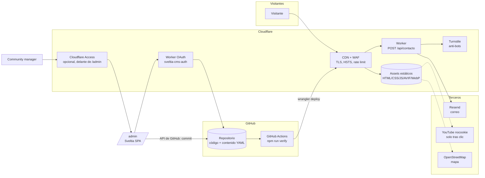
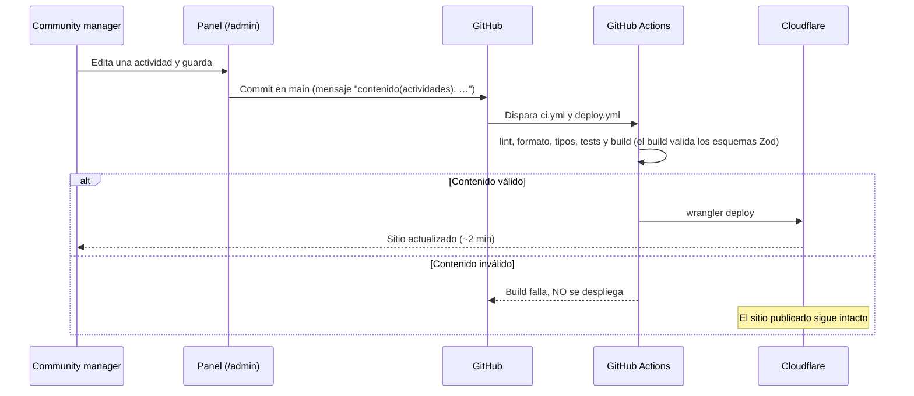

# Arquitectura e infraestructura

Propuesta técnica del sitio web de la Iglesia Presbiteriana «Pacto de Cristo». Documento dirigido a la revisión de
ingeniería: qué se construyó, por qué, qué se descartó, cuánto cuesta y cómo se despliega.

## 1. Resumen ejecutivo

| Requisito | Respuesta |
| --- | --- |
| Costo bajo | **≈ CLP 9.940 + IVA al año** (solo el dominio `.cl`; verificar tarifa en nic.cl). Hosting, CDN, CI, anti-bots y correo transaccional en planes gratuitos. |
| Fácil de administrar | Panel web (Sveltia CMS) en español, con formularios, ayudas y límites por campo. El community manager no toca código. |
| Sin PHP | No hay PHP, ni servidor de aplicaciones, ni base de datos. El sitio público es HTML estático. |
| Seguridad | Superficie de ataque mínima: una sola ruta dinámica (`POST /api/contacto`) con defensa en capas; CSP estricta por hashes; contenido validado antes de publicarse. Ver [SEGURIDAD.md](SEGURIDAD.md). |
| Mantenibilidad | TypeScript estricto, esquemas Zod, 49 tests, lint de accesibilidad, CI que bloquea despliegues inválidos, historial completo en Git. |

## 2. Diagrama

Lectura del diagrama:

- **Ruta pública:** el visitante solo recibe archivos estáticos desde el CDN. El único código que se ejecuta en servidor es
  el Worker del formulario.
- **Ruta editorial:** el panel es una aplicación de página única que conversa directamente con la API de GitHub. El
  único componente de servidor propio del panel es el intercambio OAuth (Worker `sveltia-cms-auth`, con lista blanca
  de dominios). Cada guardado es un commit; CI valida y despliega.

## 3. Por qué un sitio estático (Jamstack)

| Riesgo típico de un CMS tradicional | Situación en esta arquitectura |
| --- | --- |
| Inyección SQL, robo de base de datos | No hay base de datos. |
| Plugins o temas vulnerables (WordPress/PHP) | No hay plugins ejecutándose en servidor. |
| Servidor/SO sin parches | No hay servidor propio: Cloudflare opera el runtime. |
| Panel de login expuesto a fuerza bruta | La autenticación la hace GitHub (con 2FA obligatorio); opcionalmente Cloudflare Access antes del panel. |
| XSS almacenado vía editor | Contenido tipado y escapado por Astro; URLs solo `https://`; CSP por hashes bloquea scripts no autorizados. |
| Caídas por tráfico | Todo el sitio se sirve desde el CDN global. |
| Respaldos | Git *es* el respaldo: historial completo, auditable y reversible. |

## 4. Decisiones (ADR resumidos)

### ADR-01 · Generador estático: Astro 7

- **Decisión:** Astro 7.4.2 con salida estática y una ruta *on-demand*.
- **Motivos:** cero JavaScript por defecto (solo 4 scripts propios y pequeños: menú móvil, reproductor de sermones, formulario y ocultar actividades pasadas; más Turnstile en «Visítanos»), CSP estable por hashes
  (`security.csp`), optimización de imágenes en build, API de fuentes autoalojadas, colecciones de contenido con Zod.
  Adaptador oficial para Cloudflare.
- **Consecuencia:** el contenido "vivo" (actividades próximas) depende del momento del build → ver §6.

### ADR-02 · Hosting: Cloudflare Workers (assets estáticos + 1 Worker)

- **Decisión:** Cloudflare, plan gratuito.
- **Alternativas:** Netlify y Vercel (similares en lo estático; Vercel Hobby es de uso no comercial y el plan gratuito de
  Netlify es por créditos), VPS propio (costo y parches).
- **Motivos:** CDN + WAF + DNS + Turnstile + Access + Workers en un solo proveedor y sin costo; `_headers` nativo; la
  vista previa local corre en `workerd`, el mismo runtime de producción.

### ADR-03 · Panel: Sveltia CMS (Git-based)

- **Decisión:** Sveltia CMS 0.252.0, servido desde el propio dominio: `scripts/build-admin.mjs` **empaqueta con Vite**
  el paquete npm (entrada `src/admin/cms.js` → `public/admin/app/cms.js`) en cada build. Se descartó el bundle
  «CDN» (`dist/sveltia-cms.js`: descargaba fuentes desde `cdn.jsdelivr.net` y traducciones desde `unpkg.com`, y la
  CSP lo bloqueaba) y también servir el módulo npm sin empaquetar (importa JSON «crudo», que el navegador rechaza).
  Detalle en [SEGURIDAD.md § 3.2](SEGURIDAD.md).
- **URL:** en producción el panel vive en `/admin/` (Cloudflare redirige `/admin/index.html` → `/admin/`); en
  desarrollo local se abre `/admin/index.html`.
- **Alternativas descartadas:**

| Opción | Por qué no |
| --- | --- |
| WordPress / PHP | Requisito explícito de evitar PHP; superficie de ataque y mantenimiento de plugins. |
| Keystatic | Necesita rutas de API en servidor con Node.js; no encontramos evidencia de soporte en Cloudflare Workers. |
| Payload, Strapi, Directus | Requieren servidor y base de datos propios: costo mensual, parches y respaldos. |
| Decap CMS | Viable. Usa el **mismo `config.yml`** que Sveltia: es el plan B sin migrar contenido. |

- **Riesgo asumido:** Sveltia es pre-1.0. Mitigación: versión fijada, configuración compatible con Decap y contenido en
  YAML plano (portable a cualquier herramienta).

### ADR-04 · Formulario de contacto: Worker + Turnstile + Resend

- **Decisión:** `POST /api/contacto` en un Worker; verificación Turnstile en servidor; envío por la API HTTP de Resend.
- **Motivos:** no se almacenan mensajes (minimización de datos, Ley 21.719); la lógica está aislada en
  `src/lib/contact/` y probada con `Request` estándar, independiente del framework.

### ADR-05 · Privacidad por diseño

- Sin cookies de seguimiento. YouTube se carga solo tras el clic (`youtube-nocookie.com`); la portada del video es una
  imagen local. Mapa de OpenStreetMap. Fuentes autoalojadas (sin Google Fonts).

## 5. Flujo editorial

- **Contenido inválido nunca se publica.** Los esquemas de `src/content.config.ts` validan largos, formatos de hora,
  fechas coherentes, URLs `https://`, texto alternativo obligatorio en imágenes, etc. El panel aplica los mismos límites
  (`public/admin/config.yml`) para que el error se vea antes de guardar.
- **Rollback:** `git revert <commit>` → CI vuelve a desplegar la versión anterior.
- **Auditoría:** cada cambio queda atribuido al usuario de GitHub que lo hizo, con fecha y diferencia exacta (opcional: exigir commits firmados en la protección de `main`).

## 6. Contenido dependiente del tiempo

El sitio es estático, pero «Próximas actividades» cambia con el calendario. Dos mecanismos complementarios:

1. **Rebuild diario programado** (`.github/workflows/deploy.yml`, cron `0 7 * * *` UTC = 04:00 en horario de verano de
   Chile, 03:00 en invierno): regenera y publica el sitio cada madrugada aunque nadie edite.
2. **Script en el navegador** (`src/components/HidePastEvents.astro`): oculta las actividades cuyo término
   (`data-ends`) ya pasó desde el último build. Si no quedan visibles, muestra el mensaje de estado vacío.

Las fechas se calculan y muestran siempre en `America/Santiago` (`src/lib/dates.ts`), sin importar la zona horaria del
servidor de build (cubierto por tests).

## 7. Gobernanza del contenido

| Contenido | Quién lo edita | Cómo |
| --- | --- | --- |
| Aviso, versículo, portada, horarios, actividades, sermones, ministerios, recursos | Community manager | Panel `/admin` |
| Textos doctrinales y confesionales (Quiénes somos, Qué creemos, Culto y sacramentos) | Equipo técnico, con aprobación del Consistorio | Pull Request con revisión obligatoria (`CODEOWNERS`) |

Los textos doctrinales quedan **fuera del panel a propósito**: su modificación es una decisión del gobierno de la
iglesia, no una tarea de difusión. `.github/CODEOWNERS` lo formaliza (requiere activar «Require review from Code Owners»
en la protección de `main`; los nombres de equipo son de ejemplo hasta crear la organización):

| Ruta | Revisores |
| --- | --- |
| `src/content/` | Comunicaciones + equipo técnico |
| `src/pages/que-creemos.astro`, `quienes-somos.astro`, `culto-y-sacramentos.astro` | Consistorio |
| `src/pages/privacidad.astro` | Consistorio + equipo técnico |
| `public/_headers`, `public/admin/`, `astro.config.mjs`, `wrangler.jsonc`, `.github/`, `src/lib/contact/` | Equipo técnico |

Nota: los commits que hace el panel van directo a `main`; si se exige revisión también para `src/content/`, hay que
activar el flujo editorial de Sveltia, `publish_mode: editorial_workflow` (borrador → revisión → publicación mediante
Pull Requests), para que esos cambios también pasen por revisión.

## 8. Costos

| Servicio | Plan | Costo mensual | Costo anual | Límite relevante del plan gratuito |
| --- | --- | --- | --- | --- |
| Cloudflare Workers + assets estáticos | Free | $0 | $0 | Solicitudes a assets estáticos sin costo; 100.000 invocaciones/día de Worker (solo el formulario las usa) |
| Cloudflare DNS, CDN, WAF básico, Turnstile | Free | $0 | $0 | 1 regla de rate limiting en plan gratuito |
| Cloudflare Access (protección de `/admin`) | Zero Trust Free | $0 | $0 | Hasta 50 usuarios |
| GitHub (repositorio + Actions) | Free | $0 | $0 | Actions ilimitado en repositorio público; cuota mensual en privado |
| Resend (correo del formulario) | Free | $0 | $0 | 3.000 correos/mes |
| Dominio `.cl` (NIC Chile) | — | — | **≈ CLP 9.940 + IVA** | Valor según calculadora de terceros; **verificar en nic.cl** |
| **Total** | | **$0** | **≈ CLP 9.940 + IVA** | |

Los límites gratuitos superan con holgura el tráfico esperable de una congregación local. Si algún día se excedieran,
el plan pagado de Workers parte en USD 5/mes.

## 9. Escalabilidad y límites

- **Tráfico:** el HTML y las imágenes se sirven desde el CDN; un pico (p. ej., una transmisión especial compartida
  masivamente) no afecta la disponibilidad.
- **Peso:** imágenes convertidas a AVIF/WebP con `srcset` en build (ej.: logo 166 kB → 8 kB; portada 101 kB → 28 kB).
- **Volumen de contenido:** el modelo Git funciona bien con cientos de entradas. Si la biblioteca de fotos creciera a
  miles de imágenes, el paso natural es mover medios a Cloudflare R2 (Sveltia lo soporta) sin cambiar el sitio.
- **Edición concurrente:** pensado para 1–3 editores. Con más, conviene activar el flujo editorial (§7).
- **Tiempo de publicación:** ~2 minutos (CI + despliegue). No apto para contenido "minuto a minuto"; no es un requisito.

## 10. Plan de despliegue por fases

| Fase | Alcance | Estado |
| --- | --- | --- |
| **0 · Maqueta local** | Sitio completo, panel en modo local, formulario con claves de prueba, tests, CSP, workflows de CI/CD, Dependabot, CodeQL y `CODEOWNERS` escritos; repositorio público en GitHub; borrador publicado con clave | **Hecho (hoy)** |
| **1 · Infraestructura base** | Organización y repositorio en GitHub (2FA obligatorio, protección de `main`); proyecto en Cloudflare; compra del dominio `.cl` y DNS en Cloudflare; secretos con `wrangler secret put` y `CLOUDFLARE_API_TOKEN`/`CLOUDFLARE_ACCOUNT_ID` en GitHub; primer despliegue por `deploy.yml` | Por iniciar |
| **2 · Panel y formulario en producción** | Worker OAuth `sveltia-cms-auth` con `ALLOWED_DOMAINS`; GitHub OAuth App; Cloudflare Access delante de `/admin`; claves reales de Turnstile; Resend con dominio verificado (SPF/DKIM); regla WAF de rate limiting para `/api/contacto` | Por iniciar |
| **3 · Contenido y operación** | Contenido real (sermones, actividades, redes), PDFs de Westminster, analítica sin cookies, envío a HSTS preload, revisión legal de la política de privacidad | Por iniciar |

## 11. Pendientes / decisiones del cliente

| Tema | Decisión requerida |
| --- | --- |
| Dominio | Nombre definitivo (la maqueta usa `pactodecristo.cl` como marcador; *por definir*) |
| GitHub | Crear la organización de la iglesia y traspasarle este repositorio (hoy público en `ddiazsanmartin-sudo/ippc-web`) |
| Correo | Se publica `ip.pactodecristo@gmail.com`. Cuando exista el dominio, evaluar una casilla `@pactodecristo.cl` reenviada a ese Gmail |
| Redes sociales | URLs reales de YouTube, Instagram y Facebook (*por definir*) |
| Teléfono | ¿Se publica un teléfono de contacto? |
| Logos | Los archivos «SVG» entregados contienen imágenes PNG incrustadas; conviene obtener los vectoriales originales |
| Recursos | PDFs autorizados de la Confesión y los Catecismos de Westminster; validar lecturas recomendadas |
| Política de privacidad | Revisión por el Consistorio y, idealmente, asesoría legal |
| Equipo editorial | Quiénes tendrán acceso al panel y quién aprueba cambios doctrinales (`CODEOWNERS`) |
